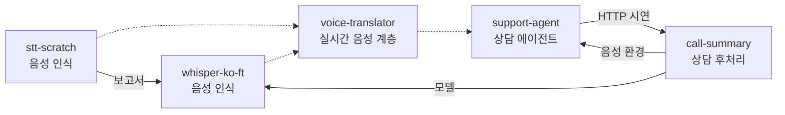

# korean-voice-ai

한국어 콜센터 음성 AI: 통화 한 건이 지나가는 음성 인식 → 실시간 음성 계층 → 상담 에이전트 → 상담 후처리를 다섯 구성 요소로 만들었고, 수치는 측정 규칙을 먼저 커밋한 뒤 쟀다.

[](https://github.com/hyeonbin123/korean-voice-ai/actions/workflows/whisper-ko-ft.yml)
[](https://github.com/hyeonbin123/korean-voice-ai/actions/workflows/stt-scratch.yml)
[](https://github.com/hyeonbin123/korean-voice-ai/actions/workflows/voice-translator.yml)
[](https://github.com/hyeonbin123/korean-voice-ai/actions/workflows/support-agent.yml)
[](https://github.com/hyeonbin123/korean-voice-ai/actions/workflows/call-summary.yml)
[](https://github.com/hyeonbin123/korean-voice-ai/actions/workflows/repo-checks.yml)
[](https://github.com/hyeonbin123/korean-voice-ai/actions/workflows/e2e.yml)


## 통화 한 건의 흐름



실선은 [코드로 이어진 곳](docs/architecture.md)(화살표는 쓰는 쪽 → 쓰이는 쪽, 시연 선은 대화 방향), 점선은 코드로 잇지 않은 통화 흐름 단계다.

## 구성 요소

| 구성 요소 | 무엇 | 대표 수치와 조건 | 테스트(CI, 2026-11-10) | 여기서부터 읽기 |
|---|---|---|---|---|
| [whisper-ko-ft](whisper-ko-ft/) | Whisper 파인튜닝 | Zeroth test CER(숫자 표기를 맞추지 않음), 학습하지 않은 large-v3-turbo 4.48% → turbo + LoRA 1.96%(같은 도메인, 처음 듣는 화자가 학습에서 본 문장). 범용으로 고른 모델과 다른 도메인 값은 [모델 선택](docs/model-choices.md#whisper-ko-ft) | 통과 779<br>건너뜀 2 | [README](whisper-ko-ft/README.md#지금까지의-결과) |
| [stt-scratch](stt-scratch/) | 처음부터 만든 스트리밍 인식 | 봉인 test CER(전체 문맥, 한글 전용 발화, 공백 제외): Zeroth 공식 test 3.67%(문장 대부분이 학습 세트에도 있어 문장 암기와 일관), 처음 보는 문장만 15.55% | 통과 284<br>건너뜀 12 | [README](stt-scratch/README.md#결과-봉인-test-2026-10-14-1회) |
| [voice-translator](voice-translator/) | 음성 번역 서비스 | 음성 인식 한국어 CER 4.57%(FLEURS test, 고른 설정만 한 번). 대화 모드에서 말을 멈춘 뒤 번역 음성을 다 받기까지(재생 시작 전) 중앙값, 한국어 원문 1.86 → 1.24초(미리 처리 전 → 후, 실제 서비스 test) | 통과 742<br>건너뜀 71<br>Vitest 184<br>Playwright 8 | [README](voice-translator/README.md#측정해서-고른-결과) |
| [support-agent](support-agent/) | 상담 에이전트와 평가 환경 | 시험용 40과제 × 4회 pass^1(한 번 시켜 성공한 비율), 규정을 도구에서도 막는 구성: qwen2.5 7B 18.1% → `qwen3.5:4b` 55.6%. 정답에 없는 쓰기는 늘었다 | 통과 2,160<br>건너뜀 36 | [README](support-agent/README.md#지금까지) |
| [call-summary](call-summary/) | 상담 후처리 LLM | 가상 대화 exact(구조 필드 모두 일치), 글 전사로만 학습한 Qwen3-4B QLoRA: test-a(같은 생성기) 95.7%, test-c(학습에 없던 업종) 55.0%([서빙 모델](docs/model-choices.md#call-summary)은 다름) | 통과 495<br>건너뜀 8 | [README](call-summary/README.md#결과-요약-3단계) |

## 운영 문제별 근거

| 문제 | 어디서 다뤘나 | 무엇을 쟀나 |
|---|---|---|
| 말 끝 판정 | [voice-translator](voice-translator/README.md#측정해서-고른-결과), [stt-scratch](stt-scratch/docs/experiments.md#서버-기본값의-종단드리프트연속-음성-측정-2026-10-29-규칙-측정-전) | 문장 잘림과 판정 지연, 확정 자막 지연 |
| 환각·되풀이 | [whisper-ko-ft](whisper-ko-ft/README.md#지금까지의-결과), [한계](whisper-ko-ft/README.md#한계) | 되풀이 오류와 재시도 디코딩 |
| 전화 음질 | [whisper-ko-ft](whisper-ko-ft/README.md#지금까지의-결과), [support-agent](support-agent/README.md#측정-결과-11단계-전화-통화-조건에서-인식만-판정-없음), [call-summary](call-summary/README.md#결과-요약-4단계-음성-인식을-거친-전사) | 전화 음질 음성의 인식과 후처리 |
| 번호 오류 | [call-summary](call-summary/docs/experiments.md#확인이-필요한-번호-표시-2026-10-04-규칙-측정-전), [support-agent](support-agent/README.md#측정-결과-9단계-음성-v4) | 번호 확인 표시, 발신 번호로 하는 본인 확인 |
| 스트리밍 지연 | [stt-scratch](stt-scratch/docs/experiments.md#서버-기본값의-종단드리프트연속-음성-측정-2026-10-29-규칙-측정-전), [voice-translator](voice-translator/README.md#측정해서-고른-결과) | 부분·확정 자막 지연, 동시통역 자막 지연 |

## 통화 한 건 시연

통화 대본 → support-agent 오프라인 앱 → 관리 API → call-summary 오프라인 앱 `POST /summarize` → 리포트. 두 앱이 모델 없이 돌아 **배선 시연(모델 없음)이고 품질 수치가 아니다**([`e2e/README.md`](e2e/README.md), [예시 리포트](e2e/examples/shop-cancel/call-report.md)).

## 측정 원칙

- 후보·지표·고르는 규칙·판정 기준을 재기 전에 구성 요소의 `docs/experiments.md`에 커밋한다.
- 후보는 개발용 묶음으로 고르고, 시험용 묶음은 실험마다 고른 것(과 기준선)만 한 번 잰다(재사용은 기록에 남김).
- 개선이 없던 판정도 적고, 수치에는 잰 데이터와 설정을 붙인다([측정 원칙](docs/measurement.md)).

## 증거 정책

- 다섯 저장소의 원래 커밋을 해시 그대로 들여 그 해시가 여기서 열린다(예: `git show a5717ce`). 파일 이력은 git 명령으로 본다([이력 따라가기](docs/history.md#이력-따라가기)).
- 기록한 수치·판정·규칙 문장은 고치지 않고 날짜를 붙여 덧붙인다. whisper-ko-ft·support-agent·call-summary의 기록 수치는 실행 기록에서 다시 계산하는 시험이 CI에서 지킨다.
- 첫 화면과 `docs/`의 수치는 [`root-numbers.toml`](root-numbers.toml)이 출처 글과 짝짓고 [`tools/check_root_numbers.py`](tools/check_root_numbers.py)가 대조한다(테스트 수·커밋 수는 센 날짜와 근거만 적는다).

## AI 도구를 쓴 방식과 검증

다섯 구성 요소는 Claude Code와 함께 만들었고 voice-translator는 일을 Codex와 나눴다. 함께한 도구는 커밋 트레일러(`Co-Authored-By`, `Agent:`)에 남아 있다. 2026-11-14에 센 원래 커밋 715개 가운데 712개에 Claude의 `Co-Authored-By`가 있다. 검증 장치: [측정 규칙 선커밋](docs/measurement.md), 기록 수치 재계산 시험([whisper-ko-ft](whisper-ko-ft/tests/test_recorded_reports.py), [support-agent](support-agent/tests/test_recorded_numbers.py), [call-summary](call-summary/tests/test_numbers.py)), stt-scratch의 [검증 기록](stt-scratch/docs/ai-verification.md), voice-translator의 교차 검토 트레일러(`Reviewed-by: claude`).

## 실행과 테스트

```bash
git clone -c core.autocrlf=false https://github.com/hyeonbin123/korean-voice-ai
```

기록 파일의 바이트를 그대로 두려고 줄바꿈 변환을 끄고 받는다(Windows Git 기본값은 줄바꿈을 바꾼다, [Windows에서 받기](docs/environments.md#windows에서-받기)). 루트에는 파이썬 프로젝트가 없다. 설치와 테스트는 각 구성 요소 폴더 안에서 한다.

| 구성 요소 | 설치 | 테스트 |
|---|---|---|
| whisper-ko-ft, stt-scratch, support-agent, call-summary | `uv sync --frozen`(whisper-ko-ft는 ct2 그룹까지) | `uv run pytest` |
| voice-translator | `backend/`에서 `uv sync --frozen`, `frontend/`에서 `npm ci` | [README의 테스트](voice-translator/README.md#테스트)(백엔드는 PostgreSQL 필요) |

루트 검사는 저장소 뿌리에서 `uv run --no-project tools/check_root_numbers.py`(수치 대조), `tools/check_links.py`(링크), `tools/check_cross_deps.py`(구성 요소 사이 의존)로 돈다. 시연은 [`e2e/README.md`](e2e/README.md).

## 문서

[구조와 연결](docs/architecture.md) · [측정 원칙](docs/measurement.md) · [모델 선택](docs/model-choices.md) · [환경](docs/environments.md) · [이력](docs/history.md) · [고지 모음](docs/notices.md)(저장소 자체의 `LICENSE` 파일은 아직 없다)
