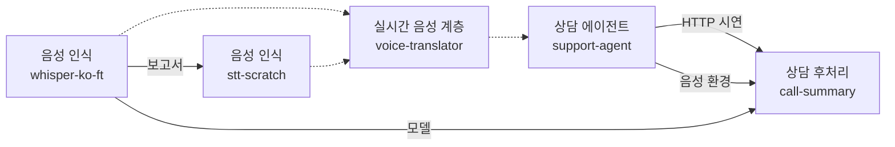

# korean-voice-ai

한국어 콜센터 음성 AI: 통화 한 건이 지나가는 네 단계(음성 인식 → 실시간 음성 계층 → 상담 에이전트 → 상담 후처리)를 단계마다 모델이나 서비스로 만들고 [측정 규칙을 먼저 커밋한 뒤](#측정-원칙) 잰 프로젝트다. 음성 인식은 파인튜닝과 처음부터 학습, 두 갈래로 다뤘다.

[](https://github.com/hyeonbin123/korean-voice-ai/actions/workflows/e2e.yml)
[](https://github.com/hyeonbin123/korean-voice-ai/actions/workflows/repo-checks.yml)

## 통화 한 건의 흐름



실선은 코드로 이어진 곳(내주는 쪽 → 쓰는 쪽), 점선은 통화 순서다(코드로 잇지 않음). 단계마다 따로 띄우며, 네 단계를 처음부터 끝까지 잇는 서버는 없다. 실시간 음성 계층은 말하는 동안 음성 인식 → 번역 → 합성을 잇는 voice-translator가 맡아 말 끝 판정과 지연을 잰다. 그 밖의 관계는 [구조와 연결](docs/architecture.md#코드로-잇지-않은-관계)에 있다.

- [통화 한 건 시연](e2e/README.md)(상담 에이전트 → 상담 후처리): 통화 대본을 support-agent 오프라인 앱에 보내고, 관리 API로 읽은 대화를 call-summary 오프라인 앱 `POST /summarize`에 넘겨 리포트를 만든다. 두 서비스가 HTTP로 이어지는지를 CI가 PR마다 확인한다. 상담 답과 후처리 기록은 규칙과 고정 답이 만들므로 **배선 시연(모델 없음)이고 품질 수치가 아니다**([예시 리포트](e2e/examples/shop-cancel/call-report.md)).
- 파일로 이어진 곳은 넷이다([구성 요소 사이 의존](docs/architecture.md#구성-요소-사이-의존)): 상담 후처리의 음성 조건 측정이 상담 에이전트의 음성 환경·읽기 규칙과 음성 인식에서 학습한 모델을 쓰고, stt-scratch의 사후 분석이 whisper-ko-ft의 발화별 보고서를 읽는다.

## 단계별 결과

| 단계: 만든 것 | 대표 수치와 조건(인식 CER은 낭독 음성 데이터 기준) | 테스트(CI, 2026-11-10) |
|---|---|---|
| 음성 인식: Whisper 파인튜닝<br>[whisper-ko-ft](whisper-ko-ft/README.md#지금까지의-결과) | Zeroth test CER(숫자 표기 차이도 오류로 셈): large-v3-turbo **4.48%** → LoRA 파인튜닝 **1.96%**(처음 듣는 화자가 학습에서 본 문장을 읽는 조건). 다른 도메인 FLEURS 한국어 test는 **5.21%** → **6.94%**(나빠졌다. 판정은 '도메인 전용'이고 [범용 모델](docs/model-choices.md#whisper-ko-ft)은 따로 골랐다) | [](https://github.com/hyeonbin123/korean-voice-ai/actions/workflows/whisper-ko-ft.yml)<br>통과 779<br>건너뜀 2 |
| 음성 인식: 처음부터 설계·학습<br>[stt-scratch](stt-scratch/README.md#결과-봉인-test-2026-10-14-1회) | 1회 잰 봉인 test CER(비스트리밍, 한글 전용 발화, 공백 제외): Zeroth 공식 test **3.67%**(문장 대부분이 학습 세트에도 있어 문장 암기 가능성), 처음 보는 문장만 **15.55%** | [](https://github.com/hyeonbin123/korean-voice-ai/actions/workflows/stt-scratch.yml)<br>통과 284<br>건너뜀 12 |
| 실시간 음성 계층: 음성 번역 서비스<br>[voice-translator](voice-translator/README.md#측정해서-고른-결과) | 한국어 인식 CER **4.57%**(FLEURS test, 고른 설정만 1회). 대화 모드에서 말을 멈춘 뒤 번역 음성을 다 받기까지(재생 시작 전) 중앙값: 한국어 원문 **1.86초 → 1.24초**(최종 처리를 미리 시작하기 전 → 후, 실제 서비스 test) | [](https://github.com/hyeonbin123/korean-voice-ai/actions/workflows/voice-translator.yml)<br>통과 742<br>건너뜀 71<br>Vitest 184<br>Playwright 8 |
| 상담 에이전트: 평가 환경 포함<br>[support-agent](support-agent/README.md#지금까지) | 시험용 40과제 × 4회 pass^1(한 번 시켜 성공한 비율), 규정 위반을 도구에서도 막는 구성: qwen2.5 7B **18.1%** → `qwen3.5:4b` **55.6%**(에이전트 모델만 바꿈). 과제가 요구하지 않은 쓰기 호출도 **6 → 13건**으로 늘었다 | [](https://github.com/hyeonbin123/korean-voice-ai/actions/workflows/support-agent.yml)<br>통과 2,160<br>건너뜀 36 |
| 상담 후처리: LLM 학습·서빙<br>[call-summary](call-summary/README.md#결과-요약-3단계) | 가상 대화 exact(구조 필드 모두 일치), 글 전사로만 학습한 Qwen3-4B QLoRA: test-a(같은 생성기) **95.7%**, test-b(다른 모델이 쓴 대화) **90.0%**, test-c(학습에 없던 업종) **55.0%**([서빙 모델](docs/model-choices.md#call-summary)은 다름) | [](https://github.com/hyeonbin123/korean-voice-ai/actions/workflows/call-summary.yml)<br>통과 495<br>건너뜀 8 |

## 운영 문제별 근거

| 문제 | 어디서 다뤘나 | 무엇을 쟀나 |
|---|---|---|
| 말 끝 판정 | [voice-translator](voice-translator/README.md#측정해서-고른-결과), [stt-scratch](stt-scratch/docs/experiments.md#서버-기본값의-종단드리프트연속-음성-측정-2026-10-29-규칙-측정-전) | 문장 잘림과 판정 지연, 확정 자막 지연 |
| 환각·되풀이 | [whisper-ko-ft](whisper-ko-ft/README.md#지금까지의-결과)([한계](whisper-ko-ft/README.md#한계)) | 되풀이 오류와 재시도 디코딩 |
| 전화 음질 | [whisper-ko-ft](whisper-ko-ft/README.md#지금까지의-결과), [support-agent](support-agent/README.md#측정-결과-11단계-전화-통화-조건에서-인식만-판정-없음), [call-summary](call-summary/README.md#결과-요약-4단계-음성-인식을-거친-전사) | 전화 음질에서의 인식과 후처리 |
| 번호 오류 | [call-summary](call-summary/docs/experiments.md#확인이-필요한-번호-표시-2026-10-04-규칙-측정-전), [support-agent](support-agent/README.md#측정-결과-9단계-음성-v4) | 번호 확인 표시, 발신 번호로 하는 본인 확인 |
| 스트리밍 지연 | [stt-scratch](stt-scratch/docs/experiments.md#서버-기본값의-종단드리프트연속-음성-측정-2026-10-29-규칙-측정-전), [voice-translator](voice-translator/README.md#측정해서-고른-결과) | 부분·확정 자막 지연, 동시통역 자막 지연 |

## 측정 원칙

- 후보·지표·고르는 규칙·판정 기준을 재기 전에 구성 요소의 `docs/experiments.md`에 커밋한다. 예: 위 whisper-ko-ft LoRA 수치는 규칙 커밋 [`51616d5`](https://github.com/hyeonbin123/korean-voice-ai/commit/51616d5)(2026-09-18) → 결과 커밋 [`a6fff10`](https://github.com/hyeonbin123/korean-voice-ai/commit/a6fff10)(2026-09-19).
- 후보는 개발용 묶음으로 고르고, 시험용 묶음은 실험마다 고른 것(과 기준선)만 한 번 잰다(다시 쓴 경우는 기록에 남긴다).
- 개선이 없던 판정도 적고, 수치에는 잰 데이터와 설정을 붙인다([측정 원칙](docs/measurement.md)).

## 증거 정책

- 구성 요소 문서에 적힌 이 프로젝트의 커밋 해시는 이 저장소에서 그대로 열린다(예: `git show a5717ce`. 다른 프로젝트나 모델·데이터 저장소의 해시는 제외). 파일 이력은 git 명령으로 본다([이력 따라가기](docs/history.md#이력-따라가기)).
- 기록한 수치·판정·규칙 문장은 고치지 않고 날짜를 붙여 덧붙인다. [whisper-ko-ft](whisper-ko-ft/tests/test_recorded_reports.py)·[support-agent](support-agent/tests/test_recorded_numbers.py)·[call-summary](call-summary/tests/test_numbers.py)의 기록 수치는 실행 기록에서 다시 계산하는 테스트가 CI에서 지킨다.
- 첫 화면과 `docs/`의 측정 수치는 [`root-numbers.toml`](root-numbers.toml)이 출처 글과 짝짓고 [`tools/check_root_numbers.py`](tools/check_root_numbers.py)가 대조한다.

## AI 도구를 쓴 방식과 검증

다섯 구성 요소는 Claude Code와 함께 만들었고 voice-translator는 일을 Codex와 나눴다. 이는 커밋 트레일러에 남아 있다(`Agent:` 줄, 그리고 2026-11-07까지의 커밋 715개 가운데 712개에 있는 `Co-Authored-By: Claude` 줄). 검증 장치: [측정 규칙 선커밋](docs/measurement.md), 위의 재계산 테스트, stt-scratch의 [검증 기록](stt-scratch/docs/ai-verification.md), voice-translator의 교차 검토(`Reviewed-by: claude`).

## 실행과 테스트

```bash
git clone -c core.autocrlf=false https://github.com/hyeonbin123/korean-voice-ai
```

기록 파일의 바이트가 바뀌지 않게 줄바꿈 변환을 끄고 받는다([Windows에서 받기](docs/environments.md#windows에서-받기)). 모델과 GPU 없이 돌려 볼 수 있는 것은 [통화 한 건 시연](e2e/README.md#로컬에서-돌리기)과 아래 루트 검사다. 단계마다 필요한 라이브러리 판이 달라(예: `transformers` 4.27.4와 5.17.0) 환경을 단계별로 두었고, 설치와 테스트는 각 구성 요소 폴더 안에서 한다([환경 문서](docs/environments.md#하나의-잠금으로-묶지-않는-이유)).

| 구성 요소 | 설치 | 테스트 |
|---|---|---|
| voice-translator | `backend/`: `uv sync --frozen`, `frontend/`: `npm ci` | [테스트 절](voice-translator/README.md#테스트)(백엔드는 DB 필요) |
| 나머지 넷 | `uv sync --frozen`(whisper-ko-ft는 `--group ct2` 추가) | `uv run pytest` |

루트 검사 셋은 저장소 루트에서 `uv run --no-project tools/<이름>.py`로 돈다: `check_root_numbers.py`(수치 대조), `check_links.py`(링크), `check_cross_deps.py`(구성 요소 사이 의존).

## 문서

[구조와 연결](docs/architecture.md) · [측정 원칙](docs/measurement.md) · [모델 선택](docs/model-choices.md) · [환경](docs/environments.md) · [이력](docs/history.md) · [고지 모음](docs/notices.md)(저장소 자체의 `LICENSE` 파일은 아직 없다)
