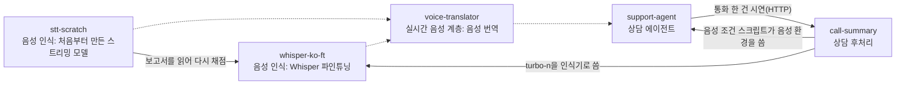

# korean-voice-ai

한국어 콜센터 음성 AI: 통화 한 건이 지나가는 음성 인식 → 실시간 음성 계층 → 상담 에이전트 → 상담 후처리를 다섯 구성 요소로 만들었고, 수치는 측정 규칙을 먼저 커밋한 뒤 쟀다.

[](https://github.com/hyeonbin123/korean-voice-ai/actions/workflows/whisper-ko-ft.yml)
[](https://github.com/hyeonbin123/korean-voice-ai/actions/workflows/stt-scratch.yml)
[](https://github.com/hyeonbin123/korean-voice-ai/actions/workflows/voice-translator.yml)
[](https://github.com/hyeonbin123/korean-voice-ai/actions/workflows/support-agent.yml)
[](https://github.com/hyeonbin123/korean-voice-ai/actions/workflows/call-summary.yml)
[](https://github.com/hyeonbin123/korean-voice-ai/actions/workflows/repo-checks.yml)
[](https://github.com/hyeonbin123/korean-voice-ai/actions/workflows/e2e.yml)

## 통화 한 건의 흐름

통화 한 건은 개념상 네 단계를 지난다. 다섯 구성 요소는 폴더마다 자기 환경을 가진 독립 프로젝트라 처음부터 끝까지 이은 하나의 서버는 없다. 그림은 구성 요소가 맡은 단계와, 이 저장소에서 실제로 이어진 곳을 보인다.



실선은 이 저장소에서 코드나 파일 경로로 이어진 곳, 점선은 통화 흐름의 다음 단계이지만 코드로 잇지 않은 곳이다([구조와 연결](docs/architecture.md)).

## 구성 요소

| 구성 요소 | 무엇 | 대표 수치와 조건 | 테스트(CI, 2026-11-10) | 여기서부터 읽기 |
|---|---|---|---|---|
| [whisper-ko-ft](whisper-ko-ft/) | 공개 한국어 음성 데이터로 Whisper를 파인튜닝하고 전후를 잰다 | Zeroth test CER, 학습하지 않은 whisper-large-v3-turbo 4.48% → turbo + LoRA 1.96%(처음 듣는 화자가 학습에서 본 문장을 읽는 조건). 같은 도메인의 결과이고, 이 LoRA는 다른 도메인이 나빠져 도메인 전용으로 판정됐다. 범용으로 고른 모델과 다른 도메인의 값은 [모델 선택](docs/model-choices.md#whisper-ko-ft) | 통과 779, 건너뜀 2 | [지금까지의 결과](whisper-ko-ft/README.md#지금까지의-결과) |
| [stt-scratch](stt-scratch/) | 한국어 스트리밍 음성 인식 모델을 처음부터 학습하고 자막 서비스로 묶는다 | 봉인 test CER(전체 문맥, 한글 전용 발화, 공백 제외): Zeroth 공식 test 3.67%(문장 대부분이 학습 세트에도 있어 문장 암기와 일관된 값), 처음 보는 문장만 15.55% | 통과 284, 건너뜀 12 | [결과 (봉인 test)](stt-scratch/README.md#결과-봉인-test-2026-10-14-1회) |
| [voice-translator](voice-translator/) | 영어↔한국어 음성 번역 웹 서비스(음성 인식 → 번역 → 음성 합성) | 음성 인식 한국어 CER 4.57%(FLEURS test, 고른 설정만 한 번). 대화 모드에서 말을 멈춘 뒤 번역 음성까지 중앙값, 한국어 원문 1.86 → 1.24초(최종 처리를 미리 시작, 실제 서비스 test) | 백엔드 주 시험 통과 742, 건너뜀 71 / 화면 단위 시험 184 / 브라우저 시험 8 | [측정해서 고른 결과](voice-translator/README.md#측정해서-고른-결과) |
| [support-agent](support-agent/) | 가상 쇼핑몰 고객센터 업무를 도구 호출로 처리하는 상담 에이전트와 그 평가 환경 | 시험용 40과제 × 4회의 pass^1(규정을 도구에서도 막는 구성): qwen2.5 7B 18.1% → `qwen3.5:4b` 55.6%. 과제가 요구하지 않은 쓰기는 늘었다([모델 선택](docs/model-choices.md#support-agent)) | 통과 2,160, 건너뜀 36 | [단계와 판정](support-agent/README.md#지금까지) |
| [call-summary](call-summary/) | 상담 전사를 상담 후처리 기록(JSON)으로 바꾸는 소형 LLM을 학습하고 서빙한다 | 생성한 가상 대화의 exact(구조 필드가 모두 맞은 비율), Qwen3-4B QLoRA: test-a(같은 생성기) 95.7%, test-c(학습에 없던 업종) 55.0%. 서빙 형태(GGUF q8_0)의 값은 [모델 선택](docs/model-choices.md#call-summary) | 통과 495, 건너뜀 8 | [결과 요약](call-summary/README.md#결과-요약-3단계) |

테스트 열은 2026-11-10 main의 GitHub Actions 실행에서 센 통과·건너뜀 수다(voice-translator는 pytest·Vitest·Playwright).

## 운영 문제별 근거

| 문제 | 어디서 다뤘나 | 무엇을 쟀나 |
|---|---|---|
| 말 끝 판정 | [voice-translator](voice-translator/README.md#측정해서-고른-결과), [stt-scratch](stt-scratch/docs/experiments.md#서버-기본값의-종단드리프트연속-음성-측정-2026-10-29-규칙-측정-전) | 말이 중간에 잘리는 비율과 판정까지 걸린 시간(대화 모드), 마지막 오디오부터 확정 자막까지의 지연(스트리밍 자막 서버) |
| 환각·되풀이 | [whisper-ko-ft 결과](whisper-ko-ft/README.md#지금까지의-결과), [한계](whisper-ko-ft/README.md#한계) | 같은 구절을 끝없이 되풀이하는 오류가 어느 모델과 추론 엔진에서 나는지, 재시도 디코딩이 막는지 |
| 전화 음질 | [whisper-ko-ft](whisper-ko-ft/README.md#지금까지의-결과), [support-agent](support-agent/README.md#측정-결과-11단계-전화-통화-조건에서-인식만-판정-없음), [call-summary](call-summary/README.md#결과-요약-4단계-음성-인식을-거친-전사) | 전화 음질로 바꾼 음성의 인식 오류와 섞어 학습한 효과, 합성 음성에 소음·먹먹함 같은 통화 조건을 얹은 인식, 전화 음질을 거쳐 다시 받아 적은 전사로 만든 후처리 기록 |
| 번호 오류 | [call-summary](call-summary/docs/experiments.md#확인이-필요한-번호-표시-2026-10-04-규칙-측정-전), [support-agent](support-agent/README.md#측정-결과-9단계-음성-v4) | 형식에 맞지 않거나 전사에 없는 번호에 붙이는 확인 표시, 받아 적은 연락처 대신 발신 번호로 하는 본인 확인 |
| 스트리밍 지연 | [stt-scratch](stt-scratch/docs/experiments.md#서버-기본값의-종단드리프트연속-음성-측정-2026-10-29-규칙-측정-전), [voice-translator](voice-translator/README.md#측정해서-고른-결과) | 부분 자막과 확정 자막까지의 지연, 긴 오디오에서 계산 시간이 늘어나는지(스트리밍 자막 서버), 말한 단어가 자막에 나타나기까지의 시간(동시통역) |

## 통화 한 건 시연

통화 대본의 고객 발화를 support-agent의 오프라인 앱에 HTTP로 보내고, 관리 API로 읽은 대화를 call-summary 오프라인 앱의 `POST /summarize`에 넘긴 뒤, 두 응답을 리포트로 쓴다. 두 앱은 모델 없이 규칙과 고정 답으로 도는 판이라 **배선 시연(모델 없음)이고 품질 수치가 아니다.** GPU가 필요 없고, CI가 main push와 pull request마다 돌려 예시 리포트와 바이트까지 견준다. 흐름·HTTP 계약·실행 명령은 [`e2e/README.md`](e2e/README.md), 결과는 [예시 리포트](e2e/examples/shop-cancel/call-report.md)에 있다.

## 측정 원칙

- 후보, 지표, 고르는 규칙, 판정 기준을 재기 전에 그 구성 요소의 `docs/experiments.md`에 커밋하고 잰다.
- 후보는 개발용 묶음으로 고르고, 시험용 묶음은 한 실험에서 고른 것(과 견줄 기준선)만 한 번 잰다. 실험을 건너 같은 시험용 묶음을 다시 쓴 구성 요소는 그 사실을 기록에 남겼다.
- 개선이 없거나 기준을 넘지 못한 판정도 같은 자리에 적고, 수치 옆에는 어떤 데이터와 설정에서 잰 값인지 조건을 적는다.

구성 요소별 규칙의 자리와 시험용 묶음을 쓰는 방식은 [측정 원칙](docs/measurement.md)에 있다.

## 증거 정책

- 다섯 원래 저장소의 커밋을 해시 그대로 들였고 이력을 다시 쓰지 않았다. 그래서 구성 요소 문서에 적힌 그 다섯 저장소의 커밋 해시가 이 저장소에서 그대로 열린다(예: `git show a5717ce`). 다른 프로젝트나 모델 저장소의 해시는 여기서 열리지 않는다([이력](docs/history.md)).
- 구성 요소마다 기록 수치를 지키는 시험이 CI에서 돈다([구성 요소별 자리](docs/measurement.md#구성-요소별-자리)).
- 첫 화면과 `docs/`에 옮겨 적은 수치는 [`root-numbers.toml`](root-numbers.toml)에 출처 파일의 글과 짝지어 선언하고, [`tools/check_root_numbers.py`](tools/check_root_numbers.py)가 두 쪽의 글자가 같은지 대조한다.
- 기록한 수치·판정·규칙 문장은 고치지 않고, 바로잡거나 더 확인한 것은 날짜를 붙여 덧붙인다.
- 파일 이력은 git 명령으로 본다. 원래 저장소 맨 위에 있던 이름(`README.md`, `pyproject.toml` 등)은 `git log --follow`에 다섯 구성 요소의 이력이 섞이므로 `git log archive/<폴더> -- <옛 경로>`로 본다([이력 따라가기](docs/history.md#이력-따라가기)).

## AI 도구를 쓴 방식과 검증

다섯 구성 요소는 Claude Code와 함께 만들었고, voice-translator는 일을 Codex와 나눴다. 어느 도구가 함께했는지는 커밋 트레일러(`Co-Authored-By`, `Agent:`)에 남아 있다. 2026-11-14에 다섯 `archive/<폴더>` 태그에서 센 원래 커밋 715개 가운데 712개에 Claude의 `Co-Authored-By`가 있다.

만든 것을 그대로 믿지 않으려고 둔 장치:

- 측정 규칙과 판정 기준을 재기 전에 커밋한다([측정 원칙](docs/measurement.md)).
- 기록된 수치를 커밋된 실행 기록에서 다시 계산하는 시험: whisper-ko-ft [`tests/test_recorded_reports.py`](whisper-ko-ft/tests/test_recorded_reports.py), support-agent [`tests/test_recorded_numbers.py`](support-agent/tests/test_recorded_numbers.py), call-summary [`tests/test_numbers.py`](call-summary/tests/test_numbers.py)(대조표 [`docs/numbers.toml`](call-summary/docs/numbers.toml)).
- stt-scratch의 [`docs/ai-verification.md`](stt-scratch/docs/ai-verification.md): 기능마다 무엇을 만들었고, 어떻게 검증했고, 검증에서 무엇이 잡혔는지(Codex의 읽기 전용 독립 검토 포함).
- voice-translator의 교차 검토: Codex가 만든 커밋에는 `Agent: codex`와 `Reviewed-by: claude`가 붙어 있다(`git log archive/voice-translator --grep "Reviewed-by:"`).

## 실행과 테스트

```bash
git clone -c core.autocrlf=false https://github.com/hyeonbin123/korean-voice-ai
```

줄바꿈 변환을 끄고 받는다. Git for Windows의 기본 설정(`core.autocrlf=true`)으로 받으면 줄바꿈이 CRLF로 바뀌어, 기록에 해시가 남은 파일의 바이트가 달라진다. 긴 경로 옵션까지 붙인 Windows용 명령과 두 옵션의 이유는 [환경](docs/environments.md#windows에서-받기)에 있다.

루트에는 파이썬 프로젝트가 없다. 설치와 테스트는 각 구성 요소 폴더 안에서 한다. 설치는 잠금 파일대로(`--frozen`) 하고, 학습·측정·서비스를 로컬에서 돌릴 때 붙이는 의존성 그룹은 [환경](docs/environments.md#구성-요소별-환경)에 있다.

| 구성 요소 | 설치 | 테스트 |
|---|---|---|
| whisper-ko-ft | `uv sync --frozen --group ct2` | `uv run pytest` |
| stt-scratch | `uv sync --frozen` | `uv run pytest` |
| voice-translator | `backend/`에서 `uv sync --frozen`, `frontend/`에서 `npm ci` | `backend/`에서 `uv run pytest`(PostgreSQL 필요, [README의 테스트](voice-translator/README.md#테스트)), `frontend/`에서 `npm run lint`, `npm test`, `npm run build`, `npm run test:a11y` |
| support-agent | `uv sync --frozen` | `uv run pytest` |
| call-summary | `uv sync --frozen` | `uv run pytest` |

저장소 뿌리에서 도는 루트 검사:

```bash
uv run --no-project tools/check_root_numbers.py   # 첫 화면과 docs/의 수치를 구성 요소 기록 글자와 대조
uv run --no-project tools/check_links.py          # 루트 문서의 상대 링크와 앵커
uv run --no-project tools/check_cross_deps.py     # 구성 요소 사이 파일 의존
```

통화 한 건 시연의 설치와 실행은 [`e2e/README.md`](e2e/README.md)에 있다.

## 문서

- [구조와 연결](docs/architecture.md): 구성 요소의 인터페이스, 통화 한 건이 지나가는 길, 구성 요소 사이 의존과 그 검사
- [측정 원칙](docs/measurement.md): 공통 원칙, 구성 요소별 규칙과 기록 수치를 지키는 시험
- [모델 선택](docs/model-choices.md): 고른 것, 비교한 대안, 고른 규칙, 결과의 조건
- [환경](docs/environments.md): 구성 요소별 파이썬·잠금 파일·의존성 그룹, 하나의 잠금으로 묶지 않는 이유, Windows에서 받기
- [이력](docs/history.md): 합친 방법, 합칠 때 바꾼 것, 이력 따라가기
- [고지 모음](docs/notices.md): 다른 곳에서 가져온 파일과 데이터·모델 라이선스의 자리(이 저장소 자체의 라이선스 파일은 아직 없다)
- [통화 한 건 시연](e2e/README.md): 흐름, HTTP 계약, 실행 명령, 한계
